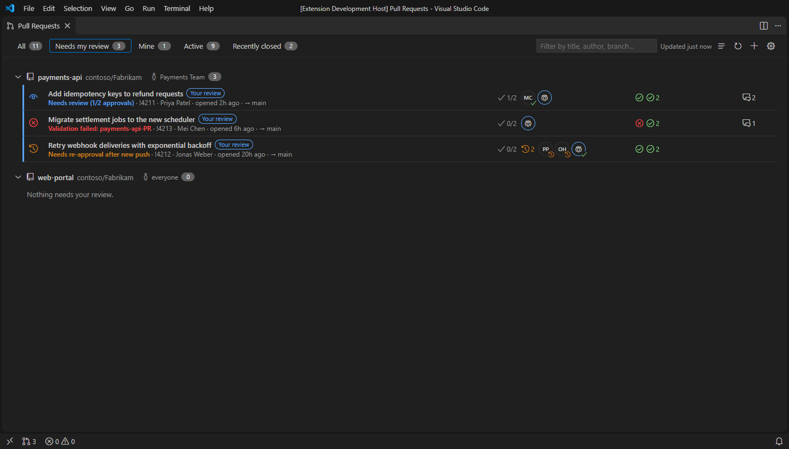
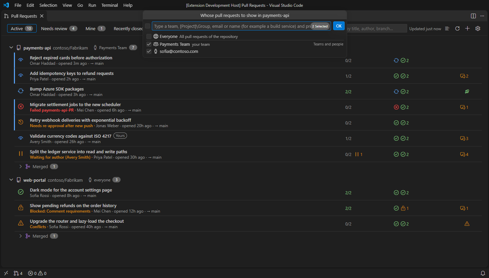
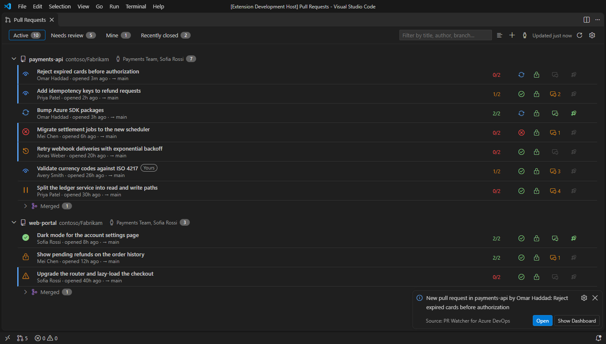

# PR Watcher for Azure DevOps

**A dashboard of your team's Azure DevOps pull requests across repositories**, right in VS Code:
which ones need your review, how many approvals they have, which approvals a new push made stale,
whether validation failed or a policy still blocks them, and whether auto-complete is set. Merged
pull requests stay listed for 60 hours, so whoever missed them can still leave comments.

Built to replace review requests in a chat, where merged pull requests stay around and people keep
opening links only to find that they are already merged.


## Features

- **Dashboard tab** (*PR Watcher: Open Dashboard*, or click the pull request count in the status
  bar): pull requests of every watched repository, grouped by repository or as one list, newest
  first, with merged ones at the end under a collapsed *Merged* row. Click a pull request to open
  it in the browser.
  Each row shows
  - its **state** as an icon, from the most to the least urgent: *Conflicts*, *Failed* (with the
    build), *Rejected*, *Waiting for author*, *Needs re-approval after new push*, *Needs review*,
    *Validation running*, *Blocked* (for example by unresolved comments), *Ready to complete*,
    *Approved, auto-complete set*, *Merged* and, if `prWatcher.showAbandoned` is on, *Abandoned*.
    Below the title, a label adds what the icon cannot say, such as the failed build, who is
    waiting for the author, or the required reviewer still missing; hover the icon for the
    state,
  - the author and age; hover the title for the pull request ID and branches,
  - **approvals** on the latest push against the approvals the branch policy requires (`1/2`,
    green when enough), and *waiting for author* and *rejected* votes; hover for the reviewers and
    their votes, including approvals of an earlier push that no longer count,
  - **validation builds** (click to open the build) and one icon for the other **branch
    policies**: a lock with the number not met yet (failed or pending), or a green check when all
    are met; hover for the policies not met and met. Optional policies are only shown when they are
    not met, such as *Link work item*, marked *(optional)*; optional builds only when they
    failed,
  - unresolved **comment threads**, **merge conflicts** and **auto-complete** (with the merge
    strategy),
  - a blue bar on the left when it needs your review, and *Yours* for your own.

  The tabs at the top count the active pull requests, those that need your review and yours, and
  list the recently closed ones; type to filter by title,
  author, branch or state.

  

- **Watch teams, groups or people per repository**: the pull requests of the members of a team
  (`AIO Connectors Team`), of a group (`[Project]\Group`, nested groups included), of people
  (`someone@contoso.com`), of anyone by the name Azure DevOps shows as a pull request's author,
  such as agents (`Agency`), build services (`One Build Service (contoso)`) or people
  (`Jane Doe`), or everyone's. A name that is not a team of the repository's project or a group
  of it is matched against the authors' names; a `[Project]\Group` that does not exist is reported
  on the repository without hiding the other authors' pull requests.
  *PR Watcher: Add Repository…* takes the URL of a
  repository or of its pull requests page (pasted from the clipboard if it holds one) and offers
  your teams of that project.

  

- **Notifications** for new pull requests of the watched authors (see `prWatcher.notifications`),
  and the **status bar** shows how many pull requests need your review, with a tooltip that lists
  them.

  

- **Recently closed**: merged pull requests stay listed for
  `prWatcher.closedRetentionHours` (60 by default), with the time until they disappear. They are
  collapsed under *Merged* at the end of each repository (click to expand); the *Recently closed*
  filter lists them directly.

The dashboard checks for changes every 2 minutes while the VS Code window is focused or the
dashboard is visible, and right away when you come back to VS Code or to the dashboard (for example
after voting in the browser), unless it checked in the last 15 seconds. It opens with the pull
requests of the last check.

## How the state is determined

PR Watcher reads the pull request, its reviewers, its [policy
evaluations](https://learn.microsoft.com/rest/api/azure/devops/policy/evaluations) and its comment
threads:

- **Approvals** count people who voted *Approved* or *Approved with suggestions*, not the author
  and not group reviewers (a group's vote reflects its members).
- **Re-approval after a new push**: when the *Minimum number of reviewers* policy requires a vote
  on the last iteration, the approvers it lists for the latest push are current; other approvals
  are of an earlier push. (When the policy resets votes on new pushes instead, the votes are
  already back to *No vote*.)
- **Needs review** while a blocking reviewer policy (*Minimum number of reviewers*, *Required
  reviewers*, *Proof of presence*) is not met, a required reviewer has not approved, or, without
  reviewer policies, nobody has approved.
- **Validation failed** when a blocking build policy failed or expired; optional builds are only
  shown when they failed.
- **Blocked** by other blocking policies that are not met, such as comment requirements, work item
  linking or status checks. *Require a merge strategy* is only met when completing, so it is
  ignored until then.
- **Needs your review** (the blue bar and the *Needs review* tab) applies to pull requests
  that still need reviews, that you have not approved
  on their latest push and did not reject or wait on, and that are not yours or drafts. In
  repositories that show everyone's pull requests, only those where you or one of your groups is a
  reviewer count.

## Settings

| Setting | Default | Description |
| --- | --- | --- |
| `prWatcher.repositories` | `[]` | Repositories to watch: URLs, or `{ "url": "…", "authors": ["…"] }` to override `prWatcher.authors` for that repository. |
| `prWatcher.authors` | `[]` | Whose pull requests to show where a repository has no `authors`: team names (of each repository's project), groups such as `[Project]\Group` or `[TEAM FOUNDATION]\Group`, emails, or the name shown for pull request authors, such as `Agency` or `One Build Service (contoso)`. Empty or `*` shows everyone's. |
| `prWatcher.closedRetentionHours` | `60` | How long merged and abandoned pull requests stay listed, in hours. |
| `prWatcher.showAbandoned` | `false` | List abandoned pull requests too, like merged ones. |
| `prWatcher.showDrafts` | `false` | List draft pull requests. |
| `prWatcher.refreshIntervalSeconds` | `120` | How often to check for changes while the window is focused. |
| `prWatcher.notifications` | `all` | `off`, `reviewRequested` (you or one of your groups is a reviewer) or `all` (every new pull request of the watched authors except yours). |
| `prWatcher.statusBar` | `true` | Show the number of pull requests that need your review in the status bar. |
| `prWatcher.authentication` | `microsoft` | `microsoft` (the Microsoft account of VS Code's Accounts menu), `azureCli` (`az login`) or `pat` (a personal access token with *Code (Read)* scope). |
| `prWatcher.tenant` | `""` | Microsoft Entra tenant to sign in to, when the organization is not in your account's home tenant. |

For example:

```jsonc
"prWatcher.repositories": [
  { "url": "https://dev.azure.com/contoso/Fabrikam/_git/payments-api", "authors": ["Payments Team"] },
  { "url": "https://dev.azure.com/contoso/Fabrikam/_git/web-portal", "authors": ["Payments Team", "sofia@contoso.com"] },
  "https://dev.azure.com/contoso/Fabrikam/_git/shared-libraries"
]
```

## Commands

| Command | Description |
| --- | --- |
| `PR Watcher: Open Dashboard` | Open the dashboard tab. |
| `PR Watcher: Refresh` | Check for changes now. |
| `PR Watcher: Add Repository…` | Watch a repository, given its URL, and choose whose pull requests to show. |
| `PR Watcher: Edit Watched Authors…` | Change whose pull requests to show in a repository. |
| `PR Watcher: Remove Repository…` | Stop watching a repository. |
| `PR Watcher: Sign In to Azure DevOps` | Sign in with the configured authentication. |
| `PR Watcher: Set Personal Access Token…` | Store a personal access token and use it. |
| `PR Watcher: Show Log` | Show the requests to Azure DevOps (at *Trace* level) and errors. |

## Authentication and privacy

By default PR Watcher asks VS Code for a Microsoft account token for Azure DevOps (the first time,
use *Sign In* on the dashboard). Alternatively it uses the Azure CLI's account or a personal access
token, which is kept in VS Code's secret storage. It only reads: pull requests, policy evaluations,
comment threads, team and group members, and your identity. Requests go only to `dev.azure.com`
and `vssps.dev.azure.com`; nothing is sent anywhere else.

## Limitations

- Azure DevOps Services only (`dev.azure.com` and `*.visualstudio.com`), not Azure DevOps Server.
- Each VS Code window checks on its own while it is focused or shows the dashboard.

## Install

Install it from the
[Visual Studio Marketplace](https://marketplace.visualstudio.com/items?itemName=luiscantero.pr-watcher),
search for **PR Watcher** in VS Code's Extensions view, or run:

```powershell
code --install-extension luiscantero.pr-watcher
```

## Build from source

Requirements: Node.js 20+.

```powershell
npm install
npm test          # unit tests
npm run package   # writes pr-watcher-<version>.vsix
code --install-extension pr-watcher-0.1.1.vsix
```

For development, run `npm run watch` and press `F5` (*Run Extension*).

### Screenshots

`npm run screenshots` recreates the images in `images/` from a fictional organization served by a
local fake Azure DevOps, in a downloaded VS Code. The images are not packaged; the Marketplace
shows them from GitHub, so push them before publishing.

`npm run screenshots -- --live` instead shows the repositories in `PR_WATCHER_LIVE_REPOS`
(comma-separated URLs, authors in `PR_WATCHER_LIVE_AUTHORS`) with the Azure CLI's account and
saves the screenshot in the temp folder, to check real data.

### Release

1. Set the new version (`npm version <x.y.z> --no-git-tag-version`), add it to `CHANGELOG.md`,
   and update the VSIX file name in the `code --install-extension` example above.
2. Commit as `Release v<x.y.z>`, tag it (`git tag -a v<x.y.z> -m v<x.y.z>`), and push the commit
   and the tag.
3. `npm test` and `npm run package`.
4. Upload `pr-watcher-<x.y.z>.vsix` at
   [marketplace.visualstudio.com/manage/publishers/luiscantero](https://marketplace.visualstudio.com/manage/publishers/luiscantero)
   (or `npx vsce publish --packagePath pr-watcher-<x.y.z>.vsix`).

## Feedback

Report issues and ideas at
[github.com/luiscantero/PrWatcher/issues](https://github.com/luiscantero/PrWatcher/issues).
